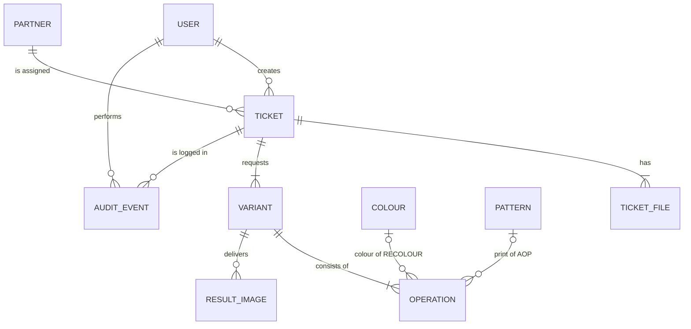

# Recolour Ticket Manager

A small Vue 3 + Express project for managing photo recolour requests: creating tickets, sending them to external partners, following their progress, and approving or rejecting the results.

## The assignment

The task is to build a small project around four mock recolour tickets (`Ticket 1–4`, supplied as the separate `recolour-case` folder, which is not part of this repository), using **Vue 3** for the frontend and **Express** for the backend. The suggested scope is:

1. **Ticket creation**: a form with photo ID, style, priority and partner.
2. **Ticket queue**: all tickets with status (Pending, Sent, In Progress, Completed, Rejected) and filters.
3. **Partner integration**: simulate sending tickets to partners and show receipt status.
4. **Approval & storage**: approve to store in "Approved Photos"; reject to return to the queue.
5. **Navigation**: main menu and sidebar (Queue, Approved Library, Partner Overview).

Nice to have: role-based views (Operator creates tickets, Manager approves) and a small KPI dashboard.

## Getting started

Requires Node.js 20 or newer.

```bash
npm install     # installs both backend and frontend (npm workspaces)
npm run dev     # API on http://localhost:3000, web app on http://localhost:5173
```

The Vite dev server proxies `/api` to the Express backend, so the frontend only talks to its own origin. The API is versioned: all endpoints live under `/api/v1` (for example `GET /api/v1/health`).

```bash
npm test        # runs the backend and frontend tests (vitest)
npm run test:e2e # drives the app in a real browser (Playwright), see *Tests*
npm run build   # builds the frontend
```

```
backend/    Express API (ES modules)
frontend/   Vue 3 + Vite, Vue Router, Pinia, PrimeVue 4
e2e/        End-to-end tests (Playwright)
```

The four case tickets are created when the API starts, so the app is never empty. Their photos are read from the `recolour-case` folder next to this project (or the folder in `RECOLOUR_CASE_DIR`); without it a small placeholder image is used. Data is kept in memory and starts fresh on every start; uploaded files go to `backend/uploads/`.

### Try it

There is no login: choose who is acting in the top bar. Seed users: Maria Hansen and Thomas Nielsen (Operator), Jens Andersen (Manager), Anh Tran and Sofie Larsen (Pixelworks), Ravi Patel (ClipMaster).

1. **Maria** (Operator): open *New ticket*, or open one of the four seeded tickets, and **Send to partner**.
2. **Anh Tran** (Pixelworks): open the ticket, **Confirm receipt**, upload a front, back and style image for every variant (or use *Fill with placeholder images (demo)*), then **Deliver**.
3. **Jens** (Manager): **Reject** with a reason, or **Approve** after the clipping-path check.
4. After a rejection, Maria sends the ticket again (round 2) and Anh Tran delivers again.
5. Look at the *Approved Library*, the *Partner Overview* and the *Dashboard*. As **Ravi Patel**, a Pixelworks ticket does not exist (`404`).

### How the assignment is covered

| Brief | Where |
|---|---|
| Ticket creation (photo ID, style, priority, partner) | *New ticket*: photos are uploaded and the photo ID is taken from the file name; the requested look is the variants (colour, optionally AOP) |
| Ticket queue with status and filters | *Queue*: status, priority, partner, search and created date, with sorting and paging |
| Partner integration, receipt status | A partner user acknowledges, uploads results and delivers; *Partner Overview* shows sent, receipt and completed per ticket |
| Approval and storage; reject returns to the queue | Approve makes the results appear in the *Approved Library*; reject returns the ticket with a reason, and it can be sent again |
| Navigation | Menu with Dashboard, Queue, New ticket, Approved Library and Partner Overview |
| Nice to have: roles, KPI dashboard | Operator, Manager and Partner user, enforced by the API; *Dashboard* with a tile per status |

### Backend structure

The backend follows ports and adapters. Dependencies point inwards: adapters depend on the application layer, which depends on the domain, never the other way round.

```
backend/src/
  domain/          The rules. No Express, no I/O.
    operations/      One file per operation (recolour, aop, resize) and the registry (index.js)
    ticket.js        Ticket input schema, required slots, building and changing a ticket
    variant.js       Variant schema (generic rules only)
    workflow.js      The status changes (send, acknowledge, deliver, approve, reject) and result images
    permissions.js   Who may do what, and who may see which ticket
    constants.js     Status, priority, role and slot names
    errors.js        The error classes that the HTTP layer turns into status codes (422, 403, 404, 409, ...)
  application/     One file per use case (createTicket, updateTicket, listTickets, workflow.js for the five
                   workflow actions, ...), the rules for uploads and for the queries, and ports.js, which
                   describes the ports (see *Backend ports*)
  adapters/        Implementations of the ports: in-memory repositories, file storage (in memory
                   and on disk), system/fixed clock
  routes/          Express routers: they read the request, call a use case and write the response
  middleware/      X-User-Id, file upload (multer) and the error handler
  seed/            Seed data: colours, patterns, partners, users and the four tickets
  compositionRoot.js  The one place that decides which adapter fills which port
  app.js, server.js   Express and start-up
backend/tests/     vitest tests for the domain, the use cases, the adapters, the seed data and the
                   API (api/, using supertest)
```

Validation uses [zod](https://zod.dev). Zod is used inside the domain on purpose: the schema is the rule, so it lives next to the rule instead of being copied into a second layer. A `ValidationError` carries one message per field path, which the API turns into a `422`.

## What the mock data contains

Each ticket folder holds three product photos of one garment (front, back and a style/detail shot), a `Guideline.rtf`, and a reference image for the print. Every guideline asks for the same set of photos to be recoloured into one or more **versions** (called *variants* below), always with the instruction to *keep the clipping path, but only one*.

| Ticket | Article no. | Reference | Reference image | Requested variants |
|---|---|---|---|---|
| 1 | 15377489 | 5081878 | `Block Libre` | Granita · Fuchsia Fedora, AOP Block Libre |
| 2 | 15377486 | 5078866 | `DOTS CLOUD DANCER` | Night Sky, AOP Dots · Hedge Green · Navy Blazer |
| 3 | 15377488 | 5078869 | `DOTS CLOUD DANCER` | Hedge Green · Navy Blazer · Night Sky, AOP Dots |
| 4 | 15377522 | 5081887 | `Block Libre` | Granita · Fuchsia Fedora, AOP Block Libre |

That is **10 variants** and **30 result images** (3 per variant) in total.

Terms used in the brief:

- **Pantone**: a standardised colour system in which every colour has a fixed name and number, so everyone means exactly the same shade. The brief gives colour *names* only (Granita, Fuchsia Fedora, Night Sky, Hedge Green, Navy Blazer), so those are what is stored.
- **AOP** (all-over print): the fabric carries a pattern over its whole surface. The reference image shows how the print should look. Variants that are not AOP are a single solid colour.

## Data model

The terms used below (ticket, variant, round, AOP and so on) are defined in the [glossary](GLOSSARY.md).



### Entities

**Ticket**: one recolour request for one garment, and **the unit of status and approval**.

| Field | Type | Notes |
|---|---|---|
| `id` | string | |
| `articleNo`, `reference` | string | e.g. `15377522`, `5081887` |
| `priority` | `LOW` \| `NORMAL` \| `HIGH` | |
| `partnerId` | string | assigned partner |
| `guidelineText` | string | the original guideline, kept verbatim |
| `singleClippingPath` | boolean | defaults to `true`; shown as a checklist item at approval |
| `status` | enum | see *Status flow* |
| `round` | integer | how many times the ticket has been sent to the partner |
| `sentAt`, `receivedAt`, `completedAt` | datetime \| null | drive the partner receipt view |
| `approvedAt`, `approvedBy` | | set when the ticket is approved |
| `rejectionReason` | string \| null | what the partner must correct |
| `createdBy`, `createdAt`, `updatedBy`, `updatedAt` | | the stamp of the latest change, for quick display |

**TicketFile**: the four files a ticket holds.

| Field | Type | Notes |
|---|---|---|
| `id`, `ticketId` | string | |
| `slot` | `FRONT` \| `BACK` \| `STYLE` \| `REFERENCE` | |
| `photoId` | string | the file name without extension, e.g. `15377522_5081887_007` |
| `file` | string | path to the uploaded file in storage |

`FRONT`, `BACK` and `STYLE` correspond to the photos ending in `_001`, `_002` and `_007`. `REFERENCE` is the print reference (`Block Libre`, `DOTS CLOUD DANCER`) and is required when any variant has an `AOP` operation.

**Variant**: one requested version of the garment, made of one or more **operations** that are combined.

| Field | Type | Notes |
|---|---|---|
| `id`, `ticketId` | string | |
| `operations` | Operation[] | at least one; see below |
| `notes` | string \| null | e.g. "Night Sky, not black" |

**Operation**: one small building block of a variant. A variant combines the blocks it needs, so new kinds of work are added as new operations without changing the ticket model.

| Operation | Data | Meaning |
|---|---|---|
| `RECOLOUR` | `colourId` | change the garment to a Pantone colour from the colour list |
| `AOP` | `patternId` | apply an all-over print (shown as a checkbox in the form) |
| `RESIZE` | `width`, `height` | change the image size |

Examples: Granita (solid) is `[RECOLOUR(Granita)]`; Fuchsia Fedora with Block Libre is `[RECOLOUR(Fuchsia Fedora), AOP(Block Libre)]`; a recoloured and resized version is `[RECOLOUR(…), RESIZE(…)]`. The mock data only uses `RECOLOUR` and `AOP`.

**Colour** and **Pattern** are small seeded lookup lists that the form chooses from, so values are consistent and can be filtered on.

| Entity | Values |
|---|---|
| Colour (`id`, `pantoneName`) | Granita, Fuchsia Fedora, Night Sky, Hedge Green, Navy Blazer |
| Pattern (`id`, `name`) | Block Libre, Dots (Cloud Dancer) |

**ResultImage**: the partner's recoloured file for one variant and one view.

| Field | Type | Notes |
|---|---|---|
| `id`, `ticketId`, `variantId` | string | the id is `<variantId>-<slot>-r<round>`, e.g. `ticket-1-v1-front-r1` |
| `slot` | `FRONT` \| `BACK` \| `STYLE` | 3 per variant and round |
| `round` | integer | which delivery it belongs to |
| `photoId` | string | the file name without extension |
| `file`, `uploadedAt` | | |

The result images are kept on the ticket (`results`). A new upload for the same variant, view and round replaces the earlier one. Images from earlier rounds are kept; the ones of the ticket's current (latest) round are the ones that count.

**Partner**: an external retouching partner (seed data): `id`, `name`. Each partner has one or more users who can log in as that partner.

**User**: `id`, `name`, `role` (`OPERATOR`, `MANAGER` or `PARTNER`) and, for a partner user, `partnerId`. There is no login: the acting user is chosen in the UI and sent with each request, and the backend takes the role from that user. This simulates identity; it is not security.

**AuditEvent**: an append-only log of every change to a ticket, so each change is stamped with what changed, who did it and when: `ticketId`, `action` (`CREATED`, `UPDATED`, `FILE_REPLACED`, `DELETED`, `SENT`, `ACKNOWLEDGED`, `RESULT_UPLOADED`, `DELIVERED`, `APPROVED` or `REJECTED`), `actorId`, `at`, `changes` (a list of `{ field, from, to }`) and an optional `comment`. A status change is one kind of event (`changes` then holds the status and the fields that came with it, e.g. `round` and `sentAt` for a send), and a rejection keeps its reason in `comment`. The latest change is also stamped on the ticket (`updatedBy`, `updatedAt`).

Validation rules worth noting: a ticket needs at least one variant, and a variant at least one operation; a variant has at most one operation of each type; each operation is validated against its own schema (an `AOP` needs a pattern, a `RESIZE` needs a width and a height); and an `AOP` operation requires a `REFERENCE` file on the ticket. Which files a ticket needs follows from its operations.

### Status flow

```
PENDING ──send──▶ SENT ──partner receipt──▶ IN_PROGRESS ──partner delivers──▶ COMPLETED
   ▲                                                                              │
   │                                                              ┌── approve ────┤
   │                                                              ▼               │
   │                                                          APPROVED        reject
   │                                                  (→ Approved Library)         │
   └─────────────── back in the queue, can be sent again ◀── REJECTED ◀────────────┘
```

- `APPROVED` is a sixth status beyond the five listed in the brief. Approving a ticket is what makes its results appear in the Approved Library.
- **Who does what:** Bestseller creates and approves; the partner carries out the work. An Operator creates and sends tickets, and a Manager approves or rejects them. The backend enforces this, not just the UI. A partner user can also log in and sees only the tickets assigned to its own partner: it acknowledges receipt, uploads the result images and delivers them. That makes this closer to an *order system* than a support-ticket system: a ticket is in effect a work order placed with a partner.
- **Dashboard KPIs** are queries over tickets, for example *pending* = `PENDING` and *awaiting approval* = `COMPLETED`.

### Who may do what

A partner is a user too. A partner user logs in (by choosing a user in the UI), sees **only the tickets assigned to its own partner**, and simulates the work by acknowledging the ticket, uploading the result images and delivering them. The backend scopes every ticket query to the acting user, so a partner can never see another partner's tickets.

| Action | Operator | Manager | Partner |
|---|---|---|---|
| See tickets | all | all | own only |
| Create, edit and delete a ticket (while `PENDING`) | yes | | |
| Send a ticket to its partner (`PENDING` or `REJECTED` → `SENT`) | yes | | |
| Acknowledge receipt (`SENT` → `IN_PROGRESS`) | | | yes, own |
| Upload result images | | | yes, own |
| Deliver (`IN_PROGRESS` → `COMPLETED`) | | | yes, own |
| Approve or reject (`COMPLETED` → `APPROVED` / `REJECTED`) | | yes | |

Delivering requires a result image for every variant and every view (front, back and style) in the current round. A rejected ticket shows the rejection reason to the partner, who corrects the work and delivers again.

How the rules answer:

- The role is checked first. An action the role may never do gives `403` (for example a Manager creating a ticket), whatever the ticket looks like.
- A ticket a user may not see is reported as `404`, exactly like a ticket that does not exist, so a partner user cannot even tell that another partner's ticket exists. This holds for the ticket, its audit log, its files and result images, and every action on it.
- Only after that is the status checked: a step in the wrong status gives `409`.

### Design decision: a ticket is approved as a whole

A ticket can contain several variants (Ticket 2 asks for three versions of the garment). The brief does not say whether each version is approved on its own. This project assumes **the whole ticket is approved, not each variant**, based on how the work most likely runs in practice: if one of the versions is not good enough, it is corrected between Bestseller and the partner until everything is right, and only then is the ticket signed off.

What follows from that:

- Status, partner receipt and approval all live on the **ticket**. Variants are the content of a ticket and have no status of their own.
- **Reject** returns the whole ticket to the queue with a comment that says what must be corrected. The ticket can then be sent to the partner again, which starts a new `round`; the new delivery gets its own result images (the earlier rounds' images are kept, and the audit log shows what happened in each round). The reason stays on the ticket until it is approved, so the partner can see what to correct.
- **Approve** sets the ticket's status to `APPROVED`. The **Approved Library** lists the partners' final, approved results: the result images of the latest round of every approved ticket, each referring back to its ticket (article number, reference number and a link). It is computed from the approved tickets, so nothing is copied.
- Approving each variant separately would be a natural extension: the status fields would move from the ticket to the variant.

### Design decision: the rules of an operation live in the operation

A variant is made of operations, and each operation defines its own rules in one small definition (`backend/src/domain/operations/`): its `schema`, the ticket files it requires (`requiredFiles`) and which of its fields point into a lookup list (`references`, for example `colourId` points to the colour list). For example, `AOP` requires a pattern and a `REFERENCE` file, and `RESIZE` requires a width and a height. The ticket and variant code is generic: it asks every operation in a variant what it requires and checks the ticket against the combined answer. It never mentions a specific operation.

- Adding a new kind of work, for example removing a background, means adding one definition and registering it. The ticket model, the file validation and the approval flow do not change.
- The rule *at most one operation of each type per variant* is generic and lives with the variant. Front, back and style are always required and live with the ticket.
- The registry sits in the domain layer, with no Express and no I/O, so each operation can be tested on its own.

### Other decisions and assumptions

- **Files are uploaded.** The create-ticket form uploads the four files together with the ticket data in one request. A file can be replaced while the ticket is `PENDING`, and the replacement is recorded in the audit log. The photo ID is taken from the file name, and the type and size of each file are validated.
- **Every change is stamped.** Each use case records an audit event with the acting user, so nothing changes a ticket without a trace.

- The brief names Pantone colours but gives **no colour codes**, so no hex values are invented.
- The brief does not say what `reference` (e.g. `5081878`) stands for. It is stored as an opaque reference.
- The `STYLE` slot is the photo ending in `_007`. In Ticket 1 it is a close-up of the fabric, so it is treated as the style/detail view (assumed to be the same in the other tickets).
- **Seed data.** The four tickets are created through the real `createTicket` use case when the server starts, so they are validated, stored and audited like any other ticket. Their guideline texts are copied from the `Guideline.rtf` files (formatting removed). The photos are uploaded from the `recolour-case` folder next to this project (or the folder in `RECOLOUR_CASE_DIR`); if the folder is not found, a tiny placeholder image is used instead. The partners (Pixelworks, ClipMaster) and the users are invented. All four tickets start as `PENDING`.
- **Uploaded files** are kept in `backend/uploads/` (not committed), one folder per ticket. The data (tickets, audit log) is only in memory and starts fresh, with the seed data, every time the server starts.
- Partners are not in the mock data and are created as seed data. The "partner integration" is a partner view of the app: a partner user logs in, sees its own tickets and simulates the work by uploading result images. For demos the ticket page has a button that fills the empty places with the ticket's own photos; it is done in the frontend with the normal upload endpoint, so the backend has no special case.

## Frontend

Vue 3 with Vue Router, Pinia and PrimeVue 4 (PrimeVue 5 needs a licence key and shows a notice without one, so version 4, which is MIT licensed, is used). The words in the UI are the glossary words.

```
frontend/src/
  api/          client.js (fetch, X-User-Id header, ApiError) and index.js (one function per endpoint)
  stores/       user.js (who is acting) and reference.js (colours, patterns, partners)
  views/        one file per page
  components/   StatusTag, PriorityTag, AuthImage, ResultsTable, AuditLog, UserPicker
  composables/  useFilteredList.js: the filters, paging and loading that Queue and Approved Library share
  ticketActions.js   which buttons a user sees on a ticket
  ticketForm.js      the new-ticket form: the request it sends and where the errors belong
  describe.js        short texts for operations, and the result images of the latest round
  dates.js           start and end of a day, for the date filters
  urlState.js        how filters, page and sorting are written to and read from the URL
frontend/tests/      vitest: the api client, the rules for buttons, the form request, one component
```

| Page | Who | What |
|---|---|---|
| **Dashboard** | all | The KPIs: a tile per status (Completed is also called *awaiting approval*); a tile opens the Queue with that status as filter. A partner user sees the numbers of its own tickets. |
| **Queue** | all | The ticket queue: search, filters on status, priority, partner and created date, sorting and paging (all done by the API). A row opens the ticket. The filters, the sorting and the page are kept in the URL (see below). |
| **New ticket** | Operator | The create form: ticket fields, one or more variants (a colour and an **AOP** checkbox that adds a pattern), and the four photos. The reference image is only asked for when a variant has AOP. The errors of the API (`422`) are shown at their fields. |
| **Ticket** | all | Photos, variants, guideline, receipt times, result images per round, and the audit log. The buttons follow the user and the status: send / delete (Operator), confirm receipt / upload result images / deliver (Partner user), approve / reject (Manager). Approving shows the clipping-path checklist; rejecting asks for the reason. |
| **Approved Library** | all | The approved results per variant, with filters (search, partner, operation, colour, approval date). A partner user sees its own. |
| **Partner Overview** | Operator, Manager | A card per partner with its number of tickets, and the receipt status of the tickets of the chosen partner (sent, receipt, completed). |

Things worth knowing:

- **Acting user.** The user picker in the top bar chooses who acts (it is remembered in the browser). The menu only shows the pages that user may open, and every request sends `X-User-Id`. The buttons are only a convenience; the backend enforces the rules.
- **Links keep the view.** The Queue and the Approved Library write their filters, sorting and page in the URL, for example `/queue?statuses=SENT,IN_PROGRESS&priority=HIGH&sort=priority&order=asc`. Send the link and the receiver sees the same list (as the user they are acting as). Only what differs from the defaults is written. The dashboard tiles are such links.
- **Photos.** An `` cannot send the `X-User-Id` header, so `AuthImage` fetches the file with the header and shows it from an object URL. A click shows the photo large.
- **Editing a ticket** (`PATCH`, replacing a photo) is in the API but has no page: a pending ticket that is wrong is deleted and created again.
- **The demo shortcut.** On an *In progress* ticket, a partner user can use *Fill with placeholder images (demo)*, which uploads the ticket's own front, back and style photo as the results.

## API (v1)

All endpoints live under `/api/v1`. There is no login: every request carries the acting user in an `X-User-Id` header, and the backend takes the role from that user (see *Who may do what*). A missing or unknown user gives `401`. Only `GET /health` and `GET /users` work without the header.

### Reference data

| Method and path | What | Who |
|---|---|---|
| `GET /users` | The users to choose from in the UI | anyone |
| `GET /colours` | The Pantone colour list | all |
| `GET /patterns` | The pattern list | all |
| `GET /partners` | Every partner as `{ id, name, total, counts }`, where `counts` has the number of tickets per status (`SENT` are the tickets that wait for a receipt) | Operator, Manager |
| `GET /partners/:id` | One partner as `{ id, name, counts, tickets }`; each ticket has `status`, `round`, `sentAt`, `receivedAt` and `completedAt`, which is the receipt status | Operator, Manager |

### Tickets

| Method and path | What | Who |
|---|---|---|
| `GET /tickets` | List with filters, sorting and paging (below). A partner sees only its own tickets. | all |
| `POST /tickets` | Create a ticket. `multipart/form-data` with a `data` field (JSON: `articleNo`, `reference`, `priority`, `partnerId`, `guidelineText`, `variants`) and the files `front`, `back`, `style` and `reference`. | Operator |
| `GET /tickets/:id` | One ticket with files, variants and results | all, partner scoped |
| `PATCH /tickets/:id` | Change priority, partner, guideline, `singleClippingPath` or variants. Only while the ticket is `PENDING`. Other fields (such as the status) are refused. | Operator |
| `PUT /tickets/:id/files/:slot` | Replace one file (`FRONT`, `BACK`, `STYLE` or `REFERENCE`). `multipart/form-data` with the file in the field `file`. Only while `PENDING`. | Operator |
| `DELETE /tickets/:id` | Delete. Only while `PENDING`. Returns `204`. | Operator |
| `GET /tickets/:id/audit` | The ticket's audit log | all, partner scoped |

**Filters on `GET /tickets`:** `status` (one or several, comma separated), `priority`, `partnerId`, `q` (searches article number and reference), `createdFrom`, `createdTo`, `sort` (`createdAt`, `updatedAt`, `priority`, `status`), `order` (`asc` or `desc`), `page` and `pageSize`.

### Workflow actions

| Method and path | Transition | Who |
|---|---|---|
| `POST /tickets/:id/send` | `PENDING` or `REJECTED` → `SENT`; starts the next round | Operator |
| `POST /tickets/:id/acknowledge` | `SENT` → `IN_PROGRESS` | Partner, own tickets |
| `PUT /tickets/:id/variants/:variantId/results/:slot` | upload one result image (`FRONT`, `BACK` or `STYLE`); `multipart/form-data` with the file in the field `file` | Partner, own tickets, `IN_PROGRESS` |
| `POST /tickets/:id/deliver` | `IN_PROGRESS` → `COMPLETED`. Without a result for every variant and view the answer is `422` with one message per missing image, e.g. `results.ticket-1-v2.BACK` | Partner, own tickets |
| `POST /tickets/:id/approve` | `COMPLETED` → `APPROVED` | Manager |
| `POST /tickets/:id/reject` | `COMPLETED` → `REJECTED`, body `{ "reason": "…" }`; a missing reason gives `422` | Manager |

Each action answers with the changed ticket. A rejected ticket can be sent again, which starts a new round. The allowed transitions are enforced in the domain layer (`domain/workflow.js`), not in the routes.

### Approved Library and dashboard

| Method and path | What | Who |
|---|---|---|
| `GET /approved-photos` | The result images of the latest round of every approved ticket, one item per variant, newest approval first. Each item refers back to its ticket (`ticketId`, `articleNo`, `reference`, `partnerId`, `approvedAt`) and has the variant's `operations` and `notes` and its `images` (`id`, `slot`, `photoId`, `url`). Filters: `q`, `partnerId`, `operation` (e.g. `AOP`), `colourId`, `approvedFrom`, `approvedTo`, `page`, `pageSize`. | all, partner scoped |
| `GET /dashboard/kpis` | `{ total, byStatus }` with the number of tickets per status (0 if none), e.g. pending = `PENDING` and awaiting approval = `COMPLETED` | all, partner scoped |
| `GET /files/:id` | Streams an uploaded or result file, scoped like tickets | all, partner scoped |

### Conventions

- **Lists** return `{ "items": [...], "total": 42, "page": 1, "pageSize": 20 }`.
- **Validation errors** return `422` with the errors per field, using the field path: `{ "errors": { "variants.1.operations.1.patternId": "A pattern is required for AOP" } }`.
- **Other errors** return `{ "error": "message" }` with `400` (malformed request), `401` (unknown user), `403` (not allowed for this role), `404` (not found), `409` (not allowed in the current status), `413` (file too large) or `415` (unsupported file type).
- **Everything that changes a ticket** writes an audit event with the acting user. A change that leaves the ticket as it was writes nothing. Deleting a ticket removes it and its files, but the audit log keeps a `DELETED` event.
- **Uploaded files** follow the rules in *Upload limits* below.
- **Photo ID:** the photo ID of an uploaded file is its file name without extension. The API never shows where a file is stored; each file has a `url` (`/api/v1/files/:id`) instead.

### Upload limits

These rules apply to every upload: the four photos of a new ticket, a replaced photo and a result image.

| Rule | Limit | Answer when broken |
|---|---|---|
| File type | JPEG or PNG. The extension (`.jpg`, `.jpeg`, `.png`) and the MIME type must agree. | `415` |
| Size | At most **30 MB per file** (the largest photo in the case is about 13 MB) | `413` |
| Empty file | Not allowed | `422` |
| Number of files | At most one per slot: `front`, `back`, `style` and `reference` when a ticket is created, and one file per request elsewhere. A file in a field the API does not know is refused. | `400` |

The create form tells the user the rule (JPEG or PNG, at most 30 MB), but the check is done by the API, whose message is shown in the form. Only the file type and size are checked, not the content of the image.

### Backend ports

The use cases depend on small interfaces; adapters implement them, and tests use in-memory versions.

| Port | Purpose |
|---|---|
| `TicketRepository` | `nextId()`, `list(filter)` (one page and the total, see *Filters on `GET /tickets`*), `get(id)`, `countByStatus({ partnerId })`, `findByFileId(fileId)` (a ticket file or a result image), `create`, `update`, `delete` |
| `UserRepository`, `PartnerRepository` | `list()` and `get(id)` |
| `CatalogRepository` | `list(kind)` and `exists(kind, id)` for colours and patterns (`kind` is `colour` or `pattern`) |
| `ApprovedPhotoReader` | `list(filter)`: the read side of the Approved Library, computed from the approved tickets |
| `FileStorage` | `save(key, buffer)`, `read(key)` (null if missing), `delete(key)`. Adapters: in memory (tests) and a folder on disk |
| `AuditLog` | append and list audit events |
| `Clock` | the current time, so tests can control it |

A ticket gets its id from `TicketRepository.nextId()`, so there is no separate id generator. Ticket ids look like `ticket-1`, and variant and file ids start with the ticket id (`ticket-1-v1`, `ticket-1-front`).

## Tests

`npm test` runs the vitest tests of both parts.

On GitHub, the workflow in `.github/workflows/ci.yml` runs `npm ci`, `npm test`, `npm run build` and the end-to-end tests on every push and pull request.

- **Backend:** the domain (validation, each operation, the workflow, permissions), the use cases (with in-memory adapters and a fixed clock), the adapters, the seed data, and the whole API through supertest (status codes, roles, partner scoping, uploads).
- **Frontend:** the API client, which buttons each role sees, the request the create form sends, the texts for operations, and the create form as a component.

- **End to end** (`npm run test:e2e`, in `e2e/`): [Playwright](https://playwright.dev) starts the API and the web app and drives them in a real browser. It runs the whole flow (create a ticket with AOP, send, receipt, upload results, deliver, reject with a reason, send again for round 2, approve after the clipping-path check, find the results in the Approved Library), and checks that the menu follows the role, that a partner user only sees its own tickets (`404` for another's), and that a link to the Queue gives the receiver the same view. The first time, install a browser with `npx playwright install chromium`. The tests share one API with its data in memory, so they run one after another. An API and a web app that already run (ports 3000 and 5173) are reused.

## Known limits

- Uploads are limited to JPEG and PNG, 30 MB per file (see *Upload limits*). A file is held in memory while it is uploaded, which is fine for this size but would call for streaming if the limit were raised a lot. The content of a file is not inspected.
- Data is only in memory and is lost when the API stops. A database would be a new adapter for the same ports.
- There is no login; the acting user is chosen in the UI and sent in `X-User-Id`. This simulates identity and is not security.
- A pending ticket cannot be edited in the UI (the API can); delete it and create it again.
- `RESIZE` exists as an operation in the API and the registry, but the form only offers colour and AOP, as the mock data does.
- Approval is per ticket, not per variant (see *Design decision: a ticket is approved as a whole*).

## Use of Claude Code

This project was built with **Claude Code** (Anthropic), working from this README and the glossary as the specification. The work was done in five steps, one at a time: the backend structure, the ticket API, the workflow with roles and partner scoping, the frontend, and this documentation. The author gave the architecture (ports and adapters), the rules and the design decisions, and set the working method: after each step the tests and the build are run and the step is committed. The code, the tests and the documentation were written by Claude Code, which also ran the app in a browser to check it. The commits carry a `Co-Authored-By` line for this reason.
