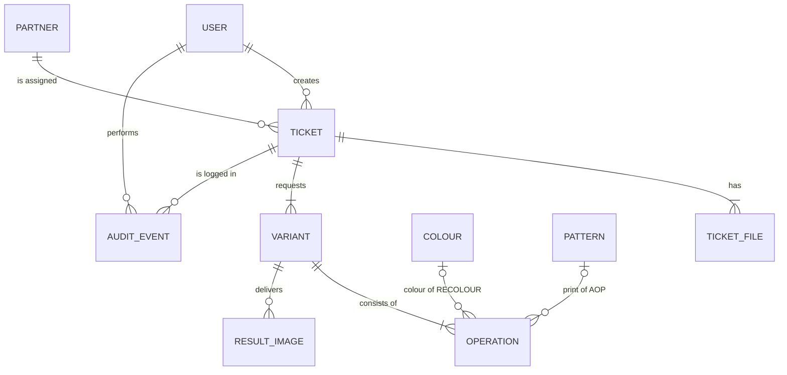

# Recolour Ticket Manager

A small Vue 3 + Express project for managing photo recolour requests: creating tickets, sending them to external partners, following their progress, and approving or rejecting the results.

## The assignment

The task is to build a small project around four mock recolour tickets (`Ticket 1–4`, supplied as the separate `recolour-case` folder, which is not part of this repository), using **Vue 3** for the frontend and **Express** for the backend. The suggested scope is:

1. **Ticket creation**: a form with photo ID, style, priority and partner.
2. **Ticket queue**: all tickets with status (Pending, Sent, In Progress, Completed, Rejected) and filters.
3. **Partner integration**: simulate sending tickets to partners and show receipt status.
4. **Approval & storage**: approve to store in "Approved Photos"; reject to return to the queue.
5. **Navigation**: main menu and sidebar (Queue, Approved Library, Partner Overview).

Nice to have: role-based views (Operator creates tickets, Manager approves) and a small KPI dashboard.

## Getting started

Requires Node.js 20 or newer.

```bash
npm install     # installs both backend and frontend (npm workspaces)
npm run dev     # API on http://localhost:3000, web app on http://localhost:5173
```

The Vite dev server proxies `/api` to the Express backend, so the frontend only talks to its own origin. The API is versioned: all endpoints live under `/api/v1` (for example `GET /api/v1/health`).

```
backend/    Express API (ES modules)
frontend/   Vue 3 + Vite, Vue Router, Pinia, PrimeVue
```

## What the mock data contains

Each ticket folder holds three product photos of one garment (front, back and a style/detail shot), a `Guideline.rtf`, and a reference image for the print. Every guideline asks for the same set of photos to be recoloured into one or more **versions** (called *variants* below), always with the instruction to *keep the clipping path, but only one*.

| Ticket | Article no. | Reference | Reference image | Requested variants |
|---|---|---|---|---|
| 1 | 15377489 | 5081878 | `Block Libre` | Granita · Fuchsia Fedora, AOP Block Libre |
| 2 | 15377486 | 5078866 | `DOTS CLOUD DANCER` | Night Sky, AOP Dots · Hedge Green · Navy Blazer |
| 3 | 15377488 | 5078869 | `DOTS CLOUD DANCER` | Hedge Green · Navy Blazer · Night Sky, AOP Dots |
| 4 | 15377522 | 5081887 | `Block Libre` | Granita · Fuchsia Fedora, AOP Block Libre |

That is **10 variants** and **30 result images** (3 per variant) in total.

Terms used in the brief:

- **Pantone**: a standardised colour system in which every colour has a fixed name and number, so everyone means exactly the same shade. The brief gives colour *names* only (Granita, Fuchsia Fedora, Night Sky, Hedge Green, Navy Blazer), so those are what is stored.
- **AOP** (all-over print): the fabric carries a pattern over its whole surface. The reference image shows how the print should look. Variants that are not AOP are a single solid colour.

## Data model

The terms used below (ticket, variant, round, AOP and so on) are defined in the [glossary](GLOSSARY.md).



### Entities

**Ticket**: one recolour request for one garment, and **the unit of status and approval**.

| Field | Type | Notes |
|---|---|---|
| `id` | string | |
| `articleNo`, `reference` | string | e.g. `15377522`, `5081887` |
| `priority` | `LOW` \| `NORMAL` \| `HIGH` | |
| `partnerId` | string | assigned partner |
| `guidelineText` | string | the original guideline, kept verbatim |
| `singleClippingPath` | boolean | defaults to `true`; shown as a checklist item at approval |
| `status` | enum | see *Status flow* |
| `round` | integer | how many times the ticket has been sent to the partner |
| `sentAt`, `receivedAt`, `completedAt` | datetime \| null | drive the partner receipt view |
| `approvedAt`, `approvedBy` | | set when the ticket is approved |
| `rejectionReason` | string \| null | what the partner must correct |
| `createdBy`, `createdAt`, `updatedBy`, `updatedAt` | | the stamp of the latest change, for quick display |

**TicketFile**: the four files a ticket holds.

| Field | Type | Notes |
|---|---|---|
| `id`, `ticketId` | string | |
| `slot` | `FRONT` \| `BACK` \| `STYLE` \| `REFERENCE` | |
| `photoId` | string | the file name without extension, e.g. `15377522_5081887_007` |
| `file` | string | path to the uploaded file in storage |

`FRONT`, `BACK` and `STYLE` correspond to the photos ending in `_001`, `_002` and `_007`. `REFERENCE` is the print reference (`Block Libre`, `DOTS CLOUD DANCER`) and is required when any variant has an `AOP` operation.

**Variant**: one requested version of the garment, made of one or more **operations** that are combined.

| Field | Type | Notes |
|---|---|---|
| `id`, `ticketId` | string | |
| `operations` | Operation[] | at least one; see below |
| `notes` | string \| null | e.g. "Night Sky, not black" |

**Operation**: one small building block of a variant. A variant combines the blocks it needs, so new kinds of work are added as new operations without changing the ticket model.

| Operation | Data | Meaning |
|---|---|---|
| `RECOLOUR` | `colourId` | change the garment to a Pantone colour from the colour list |
| `AOP` | `patternId` | apply an all-over print (shown as a checkbox in the form) |
| `RESIZE` | `width`, `height` | change the image size |

Examples: Granita (solid) is `[RECOLOUR(Granita)]`; Fuchsia Fedora with Block Libre is `[RECOLOUR(Fuchsia Fedora), AOP(Block Libre)]`; a recoloured and resized version is `[RECOLOUR(…), RESIZE(…)]`. The mock data only uses `RECOLOUR` and `AOP`.

**Colour** and **Pattern** are small seeded lookup lists that the form chooses from, so values are consistent and can be filtered on.

| Entity | Values |
|---|---|
| Colour (`id`, `pantoneName`) | Granita, Fuchsia Fedora, Night Sky, Hedge Green, Navy Blazer |
| Pattern (`id`, `name`) | Block Libre, Dots (Cloud Dancer) |

**ResultImage**: the partner's recoloured file for one variant and one view.

| Field | Type | Notes |
|---|---|---|
| `id`, `variantId` | string | |
| `slot` | `FRONT` \| `BACK` \| `STYLE` | 3 per variant and round |
| `round` | integer | which delivery it belongs to |
| `file`, `uploadedAt` | | |

**Partner**: an external retouching partner (seed data): `id`, `name`. Each partner has one or more users who can log in as that partner.

**User**: `id`, `name`, `role` (`OPERATOR`, `MANAGER` or `PARTNER`) and, for a partner user, `partnerId`. There is no login: the acting user is chosen in the UI and sent with each request, and the backend takes the role from that user. This simulates identity; it is not security.

**AuditEvent**: an append-only log of every change to a ticket, so each change is stamped with what changed, who did it and when: `ticketId`, `action` (`CREATED`, `UPDATED`, `FILE_REPLACED`, `SENT`, `APPROVED`, `REJECTED`, …), `actorId`, `at`, `changes` (a list of `{ field, from, to }`) and an optional `comment`. A status change is one kind of event. The latest change is also stamped on the ticket (`updatedBy`, `updatedAt`).

Validation rules worth noting: a ticket needs at least one variant, and a variant at least one operation; a variant has at most one operation of each type; each operation is validated against its own schema (an `AOP` needs a pattern, a `RESIZE` needs a width and a height); and an `AOP` operation requires a `REFERENCE` file on the ticket. Which files a ticket needs follows from its operations.

### Status flow

```
PENDING ──send──▶ SENT ──partner receipt──▶ IN_PROGRESS ──partner delivers──▶ COMPLETED
   ▲                                                                              │
   │                                                              ┌── approve ────┤
   │                                                              ▼               │
   │                                                          APPROVED        reject
   │                                                  (→ Approved Library)         │
   └─────────────── back in the queue, can be sent again ◀── REJECTED ◀────────────┘
```

- `APPROVED` is a sixth status beyond the five listed in the brief. Approving a ticket is what makes its results appear in the Approved Library.
- **Who does what:** Bestseller creates and approves; the partner carries out the work. An Operator creates and sends tickets, and a Manager approves or rejects them. The backend enforces this, not just the UI. A partner user can also log in and sees only the tickets assigned to its own partner: it acknowledges receipt, uploads the result images and delivers them. That makes this closer to an *order system* than a support-ticket system: a ticket is in effect a work order placed with a partner.
- **Dashboard KPIs** are queries over tickets, for example *pending* = `PENDING` and *awaiting approval* = `COMPLETED`.

### Who may do what

A partner is a user too. A partner user logs in (by choosing a user in the UI), sees **only the tickets assigned to its own partner**, and simulates the work by acknowledging the ticket, uploading the result images and delivering them. The backend scopes every ticket query to the acting user, so a partner can never see another partner's tickets.

| Action | Operator | Manager | Partner |
|---|---|---|---|
| See tickets | all | all | own only |
| Create, edit and delete a ticket (while `PENDING`) | yes | | |
| Send a ticket to its partner (`PENDING` → `SENT`) | yes | | |
| Acknowledge receipt (`SENT` → `IN_PROGRESS`) | | | yes, own |
| Upload result images | | | yes, own |
| Deliver (`IN_PROGRESS` → `COMPLETED`) | | | yes, own |
| Approve or reject (`COMPLETED` → `APPROVED` / `REJECTED`) | | yes | |

Delivering requires a result image for every variant and every view (front, back and style) in the current round. A rejected ticket shows the rejection reason to the partner, who corrects the work and delivers again.

### Design decision: a ticket is approved as a whole

A ticket can contain several variants (Ticket 2 asks for three versions of the garment). The brief does not say whether each version is approved on its own. This project assumes **the whole ticket is approved, not each variant**, based on how the work most likely runs in practice: if one of the versions is not good enough, it is corrected between Bestseller and the partner until everything is right, and only then is the ticket signed off.

What follows from that:

- Status, partner receipt and approval all live on the **ticket**. Variants are the content of a ticket and have no status of their own.
- **Reject** returns the whole ticket to the queue with a comment that says what must be corrected. The ticket can then be sent to the partner again, which starts a new `round`; the new delivery replaces the previous results, and the earlier rounds stay visible in the audit log.
- **Approve** sets the ticket's status to `APPROVED`. The **Approved Library** lists the partners' final, approved results: the result images of the latest round of every approved ticket, each referring back to its ticket (article number, reference number and a link). It is computed from the approved tickets, so nothing is copied.
- Approving each variant separately would be a natural extension: the status fields would move from the ticket to the variant.

### Design decision: the rules of an operation live in the operation

A variant is made of operations, and each operation defines its own rules in one small definition (`backend/src/domain/operations/`): its schema and the ticket files it requires. For example, `AOP` requires a pattern and a `REFERENCE` file, and `RESIZE` requires a width and a height. The ticket and variant code is generic: it asks every operation in a variant what it requires and checks the ticket against the combined answer. It never mentions a specific operation.

- Adding a new kind of work, for example removing a background, means adding one definition and registering it. The ticket model, the file validation and the approval flow do not change.
- The rule *at most one operation of each type per variant* is generic and lives with the variant. Front, back and style are always required and live with the ticket.
- The registry sits in the domain layer, with no Express and no I/O, so each operation can be tested on its own.

### Other decisions and assumptions

- **Files are uploaded.** The create-ticket form uploads the four files together with the ticket data in one request. A file can be replaced while the ticket is `PENDING`, and the replacement is recorded in the audit log. The photo ID is taken from the file name, and the type and size of each file are validated.
- **Every change is stamped.** Each use case records an audit event with the acting user, so nothing changes a ticket without a trace.

- The brief names Pantone colours but gives **no colour codes**, so no hex values are invented.
- The brief does not say what `reference` (e.g. `5081878`) stands for. It is stored as an opaque reference.
- The `STYLE` slot is the photo ending in `_007`. In Ticket 1 it is a close-up of the fabric, so it is treated as the style/detail view (assumed to be the same in the other tickets).
- Partners are not in the mock data and are created as seed data. The "partner integration" is a partner view of the app: a partner user logs in, sees its own tickets and simulates the work by uploading result images. An optional "simulate work" shortcut can fill in placeholder results for demos.
